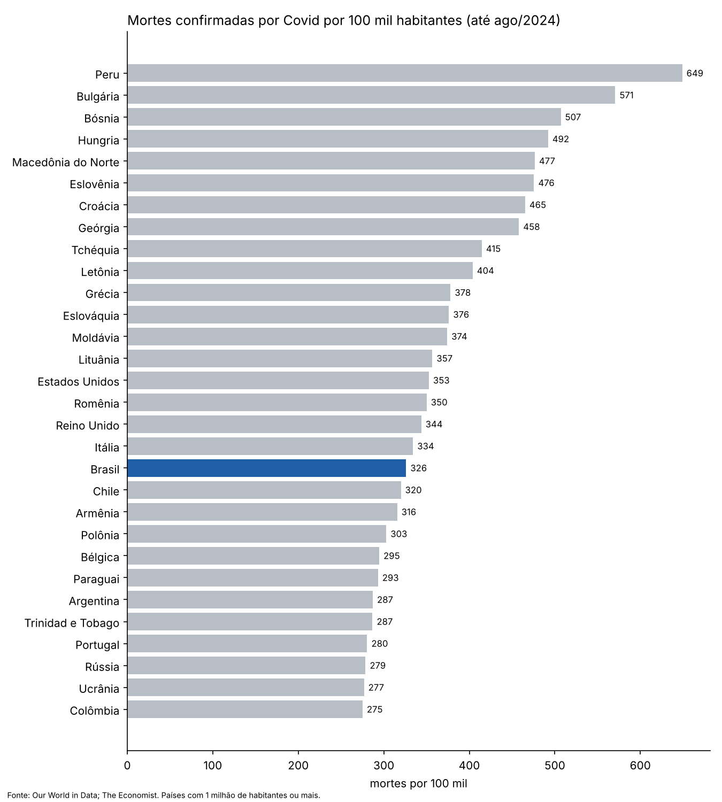
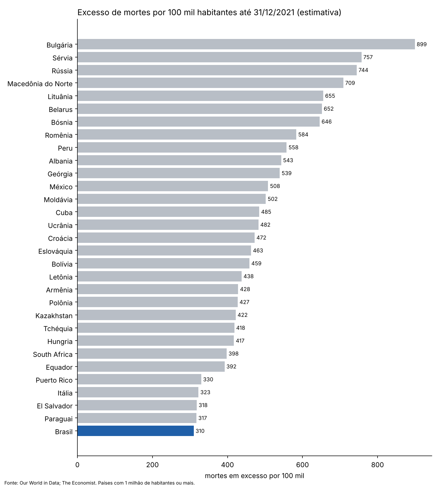
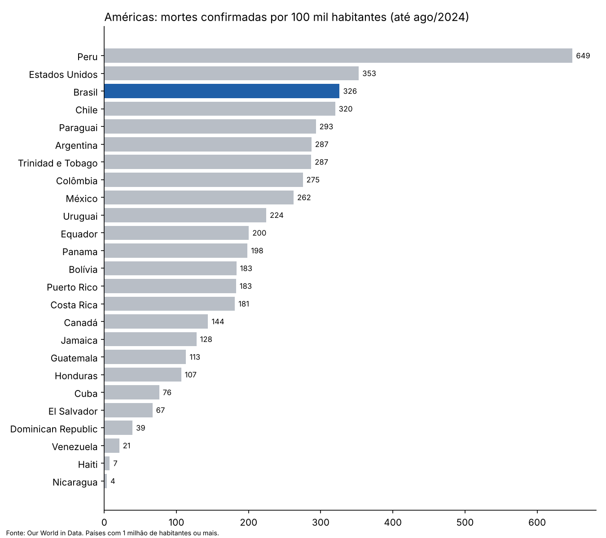
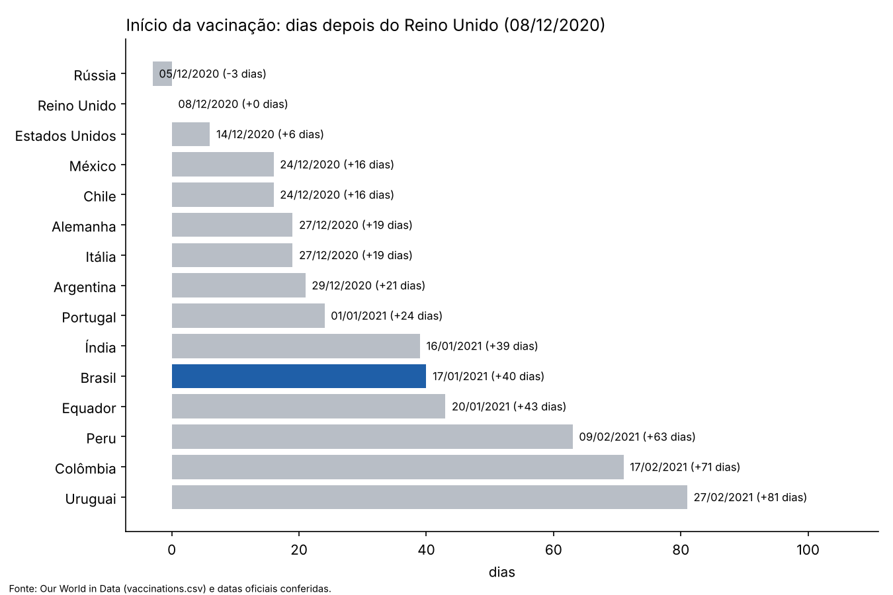
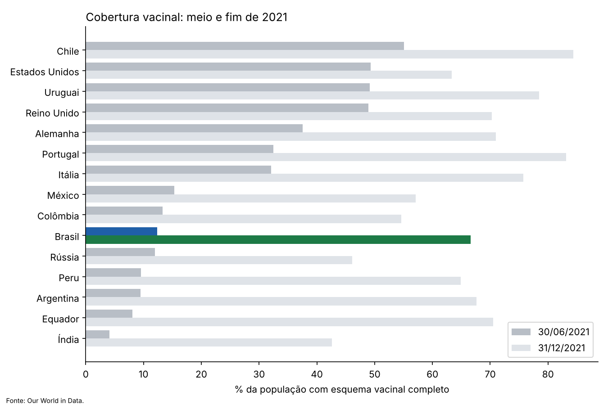

# Anatomia do Caos — a Covid-19 no Brasil em dados públicos

## Memória, verdade e reparação

Este trabalho é dedicado às **702.116 pessoas** cuja morte por Covid-19 foi confirmada no Brasil e às cerca de **230 mil** que, pelas estimativas de excesso de mortes, morreram da pandemia sem entrar na contagem oficial: perto de **934 mil vidas** ao todo.

Cada morte deixou, em média, cerca de **nove parentes próximos** de luto: avós, pais, irmãos, cônjuges e filhos. São entre **6 e 8 milhões de brasileiros** que perderam alguém que amavam. Só em 2020 e 2021, cerca de **149 mil crianças e adolescentes** perderam o pai, a mãe ou os dois.

**A Bandeira do Brasil é do povo.** Ela pertence a todos os brasileiros e não deve servir a nenhum lado político. O Brasil é do seu povo.

**O nome de D'us não deve ser profanado,** nem as Escrituras. *Profanar* é desrespeitar o que é sagrado: tratá-lo sem reverência, rebaixá-lo ou usá-lo para fins que o desonram. Usar o nome de D'us ou passagens bíblicas para justificar o descaso com a vida é uma forma de profanação.

O povo judeu repete *Zachor*, "lembra-te", e mantém viva a memória do Holocausto para que ele nunca se repita. Lembrar não é reabrir feridas: é proteger quem vem depois. Este levantamento existe pelo mesmo motivo.

**Pelo povo e para o povo brasileiro.** Dados abertos, gráficos e fontes que qualquer pessoa pode conferir, baixar e reproduzir.

Números: mortes confirmadas segundo o Our World in Data (até ago/2024); excesso de mortes pelo modelo do The Economist (≈ 934 mil até jun/2024; a diferença para as confirmadas é estimativa). "Nove parentes por morte" é o multiplicador de luto calculado para os EUA por [Verdery et al., PNAS, 2020](https://ideas.repec.org/a/nas/journl/v117y2020p17695-17701.html), aplicado aqui como aproximação (9 × 702 mil ≈ 6,3 milhões; 9 × 934 mil ≈ 8,4 milhões). Órfãos: estudo divulgado em out/2025 ([Arpen-SP](https://arpensp.org.br/noticia/covid-19-deixou-149-mil-criancas-e-adolescentes-orfaos-em-2020-e-2021)). Definição de profanação: [Dicio](https://www.dicio.com.br/profanacao/). Este texto é a posição do autor; ver [Posicionamento do autor](docs/posicionamento-do-autor.md).

> 🚧 **Em construção.** Dados e gráficos: prontos e reproduzíveis. Caso brasileiro (seção 6): conferido pela busca, com o arquivamento das fontes em andamento. Roteiro do documentário: pronto, com minutagem.

**Baixe os dados:** [planilha Excel (234 países)](dados/covid_paises.xlsx) · [CSV](dados/covid_paises.csv) · [como os números foram calculados](docs/metodologia.md)

---

## O Brasil em números

| Indicador | Brasil | Fonte |
|---|---:|---|
| Mortes confirmadas por Covid (até ago/2024) | **702.116** | Our World in Data |
| Mortes confirmadas por 100 mil habitantes | **326** | Our World in Data |
| Posição mundial (157 países com 1 milhão+ de habitantes) | **19º pior** | cálculo próprio |
| Posição nas Américas | **3º pior** (depois de Peru e Estados Unidos) | cálculo próprio |
| Excesso de mortes estimado, acumulado até jun/2024 | **≈ 934 mil** | The Economist (estimativa) |
| Início da vacinação | **17/01/2021** — 40 dias depois do Reino Unido | Our World in Data |
| População com esquema completo em 30/06/2021 | **12,4%** | Our World in Data |
| População com esquema completo em 31/12/2021 | **66,6%** | Our World in Data |

**O que é "excesso de mortes"?** É quantas pessoas morreram (de qualquer causa) acima do que seria esperado sem a pandemia. Serve para corrigir mortes por Covid que não foram testadas nem registradas. No Brasil, o excesso estimado (≈ 934 mil) é maior que as mortes confirmadas (702 mil).

---

## 1. Mortes por 100 mil habitantes no mundo

Dividir as mortes pela população permite comparar países de tamanhos diferentes. O Brasil aparece em azul.

## 2. Excesso de mortes até o fim de 2021

Pelo excesso de mortes (estimativa), o Brasil fica em 33º de 157 países: pior que a maioria, mas atrás de Peru, México, Rússia e boa parte do Leste Europeu, onde muitas mortes não foram registradas como Covid.

## 3. Américas

## 4. Quando cada país começou a vacinar

O Brasil aplicou a primeira dose em 17/01/2021: 40 dias depois do Reino Unido, 34 depois dos Estados Unidos e 24 depois de Chile e México.

## 5. Quanto da população estava vacinada

Em 30/06/2021, o Brasil tinha 12% da população com esquema completo, contra cerca de 49–55% em Estados Unidos, Reino Unido e Chile. Quando as vacinas chegaram em volume, o SUS vacinou rápido: no fim de 2021 o Brasil (67%) já tinha passado os Estados Unidos (63%). O atraso pesou justamente no primeiro semestre de 2021, os meses mais mortais da pandemia no país.

| País | 1ª dose | Dias após o Reino Unido | Esquema completo 30/06/2021 | Esquema completo 31/12/2021 | Chegou a 50% em |
|---|---|---:|---:|---:|---|
| Rússia | 05/12/2020 | -3 | 12,0% | 46,1% | 20/03/2022 |
| Reino Unido | 08/12/2020 | +0 | 49,0% | 70,3% | 05/07/2021 |
| Estados Unidos | 14/12/2020 | +6 | 49,3% | 63,4% | 09/07/2021 |
| Chile | 24/12/2020 | +16 | 55,0% | 84,4% | 22/06/2021 |
| México | 24/12/2020 | +16 | 15,3% | 57,1% | 20/11/2021 |
| Itália | 27/12/2020 | +19 | 32,1% | 75,7% | 26/07/2021 |
| Alemanha | 27/12/2020 | +19 | 37,6% | 71,0% | 26/07/2021 |
| Argentina | 29/12/2020 | +21 | 9,5% | 67,6% | 16/10/2021 |
| Portugal | 01/01/2021 | +24 | 32,5% | 83,2% | 23/07/2021 |
| Índia | 16/01/2021 | +39 | 4,1% | 42,6% | 31/01/2022 |
| **Brasil** | **17/01/2021** | **+40** | **12,4%** | **66,6%** | **21/10/2021** |
| Equador | 20/01/2021 | +43 | 8,1% | 70,5% | 08/09/2021 |
| Peru | 09/02/2021 | +63 | 9,6% | 64,9% | 15/11/2021 |
| Colômbia | 17/02/2021 | +71 | 13,3% | 54,6% | 10/12/2021 |
| Uruguai | 27/02/2021 | +81 | 49,2% | 78,4% | 01/07/2021 |

**Leitura honesta:** começar cedo não garantiu cobertura (Rússia e México começaram antes e vacinaram menos), e começar tarde não impediu cobertura alta (Uruguai). Comparar países também não isola o efeito de um governo: idade da população, desigualdade, variantes e sistema de saúde pesam. O relatório trata disso com as fontes.

## 6. O caso brasileiro: decisões do governo federal

> 🔎 **Conferido pela busca** (24/10/2026). As cópias datadas das fontes estão sendo arquivadas. Detalhes, citações e todos os links nos documentos indicados. [Como verificamos](docs/verificacao.md).

**Vacinas oferecidas e não respondidas** ([cronologia completa](docs/cronologia.md))
- **30/07/2020** — o Instituto Butantan ofereceu ao Ministério da Saúde 60 milhões de doses da CoronaVac para o fim de 2020. Segundo Dimas Covas à CPI, não houve resposta.
- **Agosto de 2020** — a Pfizer fez três ofertas (14, 18 e 26/08), com pelo menos 1,5 milhão de doses ainda em dezembro de 2020. Em 12/09/2020, o presidente da empresa escreveu ao governo: *"até o momento não recebemos uma resposta"*.
- **21/10/2020** — um dia depois de o ministro Pazuello anunciar a compra de 46 milhões de doses da CoronaVac, o presidente Bolsonaro escreveu: *"NÃO SERÁ COMPRADA"*. Em 22/10, Pazuello: *"Um manda e o outro obedece"*.
- **10/11/2020** — quando a Anvisa suspendeu temporariamente os testes da CoronaVac, o presidente escreveu: *"Mais uma que Jair Bolsonaro ganha"*.
- **Janeiro de 2021** — contrato da CoronaVac em 07/01; primeira vacinada, a enfermeira Mônica Calazans, em 17/01. Contrato da Pfizer só em março de 2021; primeiras doses em 29/04/2021.
- **O Brasil poderia ter sido o primeiro?** Dimas Covas disse à CPI que o Brasil *"poderia ser o primeiro país do mundo a começar a vacinação não fossem os percalços"*. É a avaliação dele, condicional, sobre começar a vacinar.

**Falas do presidente** — *"Chega de frescura, de mimimi […] A própria Bíblia diz […] 'Não temas'"* (04/03/2021, um dia depois de um recorde de mortes); *"gripezinha"* (20 e 24/03/2020); *"E daí? Lamento. Quer que eu faça o quê?"* (28/04/2020); *"país de maricas"* (10/11/2020); *"não vou tomar vacina e ponto final"* (15/12/2020); *"se você virar um jacaré, é problema seu"* (17/12/2020); imitação de pessoa com falta de ar (18/03/2021); live associando falsamente a vacina à aids (21/10/2021), removida pelas plataformas.

**Cloroquina** — orientação do Ministério da Saúde liberando o uso em casos leves (20/05/2020), mesmo sem evidência de benefício; produção de cerca de 3,2 milhões de comprimidos pelo laboratório do Exército em 2020; app TrateCov (jan/2021). Na CPI, Mandetta e o presidente da Anvisa, Antonio Barra Torres, confirmaram uma reunião no Planalto com proposta de mudar a bula da cloroquina para incluir a Covid. A Anvisa não aceitou.

**Quantas mortes poderiam ter sido evitadas?** ([estudos e contra-argumentos](docs/estudos.md))

| Estimativa | O que mede | Quem | Tipo |
|---|---|---|---|
| ~400 mil (4 em cada 5 mortes até jun/2021) | Diferença entre o Brasil e a média mundial | Pedro Hallal (UFPel), depoimento à CPI | Ampla: atribui toda a diferença à gestão |
| ~120 mil (1º ano) | Efeito de medidas como distanciamento e máscara | Nota técnica UFRJ/USP | Parte federal, parte estadual e municipal |
| ~47 mil idosos (piso) a ~145 mil | Vacinação mais cedo e mais rápida | Lancet Regional Health Americas (2023); pesquisadores da USP | Estreita: decisão específica |

Nenhum desses números é exato, e cada um depende de premissas explicadas no documento. Também há contra-argumentos documentados: vacinas escassas no mundo no fim de 2020, papel de estados e municípios, variante Gama.

**A CPI da Covid** ([quem foi apontado e o que aconteceu depois](docs/cpi.md)) — o relatório final, aprovado em 26/10/2021 por 7 votos a 4, pediu o indiciamento de **78 pessoas e 2 empresas**, entre elas o presidente da República por 9 crimes. Em 2022 a Procuradoria-Geral da República pediu o arquivamento da maior parte; em setembro de 2025 o STF autorizou um inquérito da Polícia Federal com 24 investigados, que segue sob sigilo. ⚖️ **Pedido de indiciamento não é condenação**, e até hoje não há condenação.

**Todos os envolvidos, um por um** — [ficha de cada pessoa](pessoas/README.md) com o que fez **a favor** e **contra** o combate à pandemia, o pedido da CPI, o que aconteceu depois e o que ela diz em sua defesa. São 107 fichas, entre elas as 78 pessoas e 2 empresas apontadas pela CPI.

**Quem atuou a favor da população** — Butantan, Fiocruz, SUS e profissionais de saúde, cientistas, Anvisa, imprensa e outros, com ato, data e ressalvas: [lista aberta](docs/quem-atuou.md).

---

## Como este trabalho é feito

1. **Fonte primária primeiro**: Senado (CPI da Covid), Anvisa, Ministério da Saúde, STF, Diário Oficial, artigos científicos revisados.
2. **Cada afirmação com link e data.** O que não tem fonte verificável sai ou fica marcado como lacuna.
3. **Fato ≠ alegação ≠ estimativa ≠ opinião.** Pedido de indiciamento não é condenação. Estimativa vem com método e limitação. Opinião do autor fica em seção própria.
4. **Só figuras públicas e atos públicos documentados.**
5. **Reprodutível**: `python scripts/gerar_graficos.py` refaz os gráficos e o CSV a partir da planilha.

Ponto de partida: o documentário *Anatomia do Caos* (dir. Dandara Ferreira, 2026), sobre os bastidores da CPI da Covid.

## Andamento

- [x] 1. Dados globais por país (planilha, CSV e gráficos)
- [x] 2. [Roteiro do documentário](docs/documentario.md) (resumo com minutagem)
- [x] 3. Cronologia Brasil: Pfizer, Butantan/CoronaVac, cloroquina (🔎)
- [x] 4. Estudos de mortes evitáveis, com contra-argumentos (🔎)
- [x] 5. CPI: pedidos de indiciamento e quem atuou no combate à pandemia (🔎)
- [ ] 6. Relatório final
- [ ] 7. Revisão independente de cada afirmação

## Estrutura

| Pasta | Conteúdo |
|---|---|
| [`dados/`](dados/) | Planilha dos 234 países; `pessoas.csv` e `atos.csv` (envolvidos e seus atos, com fonte) |
| [`graficos/`](graficos/) | Gráficos (PNG) |
| [`pessoas/`](pessoas/README.md) | Uma ficha por envolvido: atos a favor e contra, CPI, desdobramentos, defesa |
| [`docs/`](docs/) | [Cronologia](docs/cronologia.md), [estudos](docs/estudos.md), [CPI](docs/cpi.md), [quem atuou](docs/quem-atuou.md), [documentário](docs/documentario.md), [fontes](docs/fontes.md), [verificação](docs/verificacao.md), [metodologia](docs/metodologia.md), [posicionamento do autor](docs/posicionamento-do-autor.md) |
| [Arquivo de fontes](https://github.com/nk-ls/anatomia-do-caos-fontes) | Cópias datadas de cada fonte citada (repositório separado) |
| [`scripts/`](scripts/) | Código que gera tudo |

## Licença e uso

Pode copiar, compartilhar e republicar, citando a fonte. Texto, análises e gráficos: [CC BY 4.0](https://creativecommons.org/licenses/by/4.0/deed.pt_BR). Código: MIT. Os dados de terceiros seguem as licenças das fontes: Our World in Data (CC BY 4.0) e The Economist (ver repositório do modelo).

Encontrou um erro? Abra uma *issue* com o link da fonte, e a correção entra com registro.

## Agradecimentos

A ideia de coletar fontes públicas com o GitHub Actions veio do [Dossiê Cidadão](https://github.com/herminiotorres/dossie-cidadao), de Herminio Torres. Nenhum código foi copiado.
