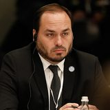

# Carlos Bolsonaro

Palácio do Planalto from Brasilia, Brasil via Wikimedia Commons · [origem](https://commons.wikimedia.org/wiki/File:Carlos_Bolsonaro_durante_Encontro_Brasil-R%C3%BAssia_em_2022.jpg)

**Cargo à época:** Vereador no Rio de Janeiro; filho do presidente  
**Grupo:** Presidência da República e família

> 🔎 Conferido pela busca; cópias datadas das fontes no [arquivo de fontes](https://github.com/nk-ls/anatomia-do-caos-fontes). Cada ato tem a sua fonte. [Como verificamos](../docs/verificacao.md). Encontrou um erro ou um ato que falta, a favor ou contra? Abra uma *issue* com a fonte.

## O que fez, em ordem

🟢 **0** a favor · 🔴 **1** contra · ⚪ **3** processual

- 🔴 **22/04/2021** · *95 dias depois da 1ª vacina · 383.502 mortes até aqui* (checagem) Publicou vídeo editado de Flávio Dino sugerindo defesa da cloroquina; Comprova classificou como enganoso [fonte](https://www.nsctotal.com.br/?p=2624269) · [cópia arquivada](https://github.com/nk-ls/anatomia-do-caos-fontes/blob/main/arquivo/nsctotal-com-br-p-2624269-734a1dd1/2026-10-24.html)
- ⚪ **11/2021** · *cerca de 10 meses depois da 1ª vacina* (fato) Cúpula da CPI entrega acusações ao MP-RJ, que encaminha o caso (vereador sem foro no STF) a promotoria criminal [fonte](https://www.bandab.com.br/politica/no-mp-do-rio-cpi-da-covid-pede-punicao-a-carlos-bolsonaro-por-fake-news/amp/) · [cópia arquivada](https://github.com/nk-ls/anatomia-do-caos-fontes/blob/main/arquivo/bandab-com-br-politica-no-mp-do-rio-cpi-da-covid-pede-punicao-a-carlos-bolsonaro-por-fake--bbc0bdf7/2026-10-24.html)
- ⚪ **09/2025** (decisão judicial) O ministro Flávio Dino (STF) autorizou inquérito da PF com 24 investigados a partir das conclusões da CPI; segue sob sigilo. [fonte](https://agenciabrasil.ebc.com.br/justica/noticia/2025-09/dino-determina-que-pf-investigue-conduta-de-bolsonaro-durante-pandemia) · [cópia arquivada](https://github.com/nk-ls/anatomia-do-caos-fontes/blob/main/arquivo/agenciabrasil-ebc-com-br-justica-noticia-2025-09-dino-determina-que-pf-investigue-conduta--17dcbea8/2026-10-24.html)
- ⚪ **18/09/2025** (decisão judicial) STF · Decisão do ministro Flávio Dino Pet 10.064/DF: Acolhe pedido da PF contra a posição da PGR. Converte a Pet em inquérito policial, com prazo inicial de 60 dias e sigilo nível 3. A Pet consta como "processo findo" em 19/09/2025 e foi baixada em 18/02/2026, porque virou inquérito sob outro número, não divulgado. Em jan/2026 a PF pediu mais prazo. Situação em out/2026: Em investigação sob sigilo. Nenhum relatório final, denúncia ou arquivamento foi localizado até 24/10/2026. [fonte](https://noticias.stf.jus.br/postsnoticias/a-pedido-da-pf-stf-determina-abertura-de-inquerito-para-investigar-resultados-da-cpi-da-pandemia/) · [cópia arquivada](https://github.com/nk-ls/anatomia-do-caos-fontes/blob/main/documentos/controle/STF_Pet10064_decisao_Dino_2025-09-18.pdf)

## Na CPI da Covid

> ⚖️ **Pedido de indiciamento não é condenação.** É uma recomendação da CPI aos órgãos de investigação. Toda pessoa tem direito à presunção de inocência.

**Crimes apontados no relatório final (26/10/2021):** incitação ao crime (CP art. 286)

## O que aconteceu depois

Investigado no inquérito da PF autorizado pelo ministro Flávio Dino (STF, Pet 10.064, set/2025), sob sigilo. Nenhuma denúncia ou condenação por fatos apontados pela CPI até out/2026, até onde as fontes mostram.

## O que a pessoa diz

Nenhuma manifestação registrada neste levantamento. A defesa ou resposta, com fonte, pode ser enviada por *issue* e será publicada.

## Fontes da ficha

- https://www12.senado.leg.br/noticias/materias/2021/10/26/veja-a-lista-dos-indiciados-da-cpi-no-relatorio-de-renan-calheiros
- https://www.correiobraziliense.com.br/politica/2025/09/7251426-dino-abre-inquerito-contra-bolsonaro-e-23-investigados-da-cpi-da-covid.html
- https://apublica.org/nota/recordar-e-votar-7-dos-13-investigados-pela-cpi-da-covid-saem-eleitos-das-urnas/

---
[← Todos os envolvidos](README.md)
