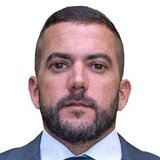

# Carlos Jordy

Foto oficial: Câmara dos Deputados · [origem](https://www.camara.leg.br/deputados/204460)

**Cargo à época:** Deputado federal  
**Grupo:** Parlamentares

> 🔎 Conferido pela busca; cópias datadas das fontes no [arquivo de fontes](https://github.com/nk-ls/anatomia-do-caos-fontes). Cada ato tem a sua fonte. [Como verificamos](../docs/verificacao.md). Encontrou um erro ou um ato que falta, a favor ou contra? Abra uma *issue* com a fonte.

## 🟢 O que fez a favor do combate à pandemia

Nenhum ato registrado ainda neste levantamento.

## 🔴 O que fez contra o combate à pandemia

- **2020** (checagem) Esteve entre os dez parlamentares que mais publicaram desinformação sobre covid-19 no Twitter, segundo a Aos Fatos [fonte](https://www.cartacapital.com.br/?p=122532) · [cópia arquivada](https://github.com/nk-ls/anatomia-do-caos-fontes/blob/main/arquivo/cartacapital-com-br-p-122532-e3bc4b38/2026-10-24.html)
- **03/2021** · *cerca de 2 meses depois da 1ª vacina* (fato) Na CCJ, foi cobrado por deputado a usar máscara; disse estar sem ela para falar e beber café e água [fonte](https://www.folhavitoria.com.br/politica/com-bia-kicis-ccj-se-transforma-em-praca-de-guerra/) · [cópia arquivada](https://github.com/nk-ls/anatomia-do-caos-fontes/blob/main/arquivo/folhavitoria-com-br-politica-com-bia-kicis-ccj-se-transforma-em-praca-de-guerra-59ebdea6/2026-10-24.html)
- **07/2021** · *cerca de 6 meses depois da 1ª vacina* (conclusão da CPI) Lista da CPI de políticos que espalharam fake news cita alegação falsa de que nem a China usava a CoronaVac, defesa de remédio sem eficácia e vinculação sem provas do vírus ao PCC [fonte](https://congressoemfoco.com.br/coluna/38037/cpi-lista-26-politicos-que-espalharam-fake-news-sobre-covid-veja-quem-sao) · [cópia arquivada](https://github.com/nk-ls/anatomia-do-caos-fontes/blob/main/arquivo/congressoemfoco-com-br-coluna-38037-cpi-lista-26-politicos-que-espalharam-fake-news-sobre--ea241435/2026-10-24.html)

## ⚪ Fatos processuais e neutros

- **07/11/2022** · *659 dias depois da 1ª vacina* (fato) PGR (vice-PGR Lindôra Araújo) pede ao STF o arquivamento da apuração preliminar de incitação ao crime aberta com base na CPI, alegando que as publicações não extrapolaram a liberdade de opinião [fonte](https://www.poder360.com.br/justica/pgr-pede-arquivamento-de-apuracao-da-cpi-da-covid-contra-bolsonaro/) · [cópia arquivada](https://github.com/nk-ls/anatomia-do-caos-fontes/blob/main/arquivo/poder360-com-br-justica-pgr-pede-arquivamento-de-apuracao-da-cpi-da-covid-contra-bolsonaro-fbcb1394/2026-10-24.html)
- **09/2025** (decisão judicial) O ministro Flávio Dino (STF) autorizou inquérito da PF com 24 investigados a partir das conclusões da CPI; segue sob sigilo. [fonte](https://agenciabrasil.ebc.com.br/justica/noticia/2025-09/dino-determina-que-pf-investigue-conduta-de-bolsonaro-durante-pandemia) · [cópia arquivada](https://github.com/nk-ls/anatomia-do-caos-fontes/blob/main/arquivo/agenciabrasil-ebc-com-br-justica-noticia-2025-09-dino-determina-que-pf-investigue-conduta--17dcbea8/2026-10-24.html)
- **18/09/2025** (decisão judicial) STF · Decisão do ministro Flávio Dino Pet 10.064/DF: Acolhe pedido da PF contra a posição da PGR. Converte a Pet em inquérito policial, com prazo inicial de 60 dias e sigilo nível 3. A Pet consta como "processo findo" em 19/09/2025 e foi baixada em 18/02/2026, porque virou inquérito sob outro número, não divulgado. Em jan/2026 a PF pediu mais prazo. Situação em out/2026: Em investigação sob sigilo. Nenhum relatório final, denúncia ou arquivamento foi localizado até 24/10/2026. [fonte](https://noticias.stf.jus.br/postsnoticias/a-pedido-da-pf-stf-determina-abertura-de-inquerito-para-investigar-resultados-da-cpi-da-pandemia/) · [cópia arquivada](https://github.com/nk-ls/anatomia-do-caos-fontes/blob/main/documentos/controle/STF_Pet10064_decisao_Dino_2025-09-18.pdf)

## Na CPI da Covid

> ⚖️ **Pedido de indiciamento não é condenação.** É uma recomendação da CPI aos órgãos de investigação. Toda pessoa tem direito à presunção de inocência.

**Crimes apontados no relatório final (26/10/2021):** incitação ao crime (CP art. 286)

## O que aconteceu depois

Investigado no inquérito da PF autorizado pelo ministro Flávio Dino (STF, Pet 10.064, set/2025), sob sigilo. Nenhuma denúncia ou condenação por fatos apontados pela CPI até out/2026, até onde as fontes mostram.

## O que a pessoa diz

Nenhuma manifestação registrada neste levantamento. A defesa ou resposta, com fonte, pode ser enviada por *issue* e será publicada.

## Fontes da ficha

- https://www12.senado.leg.br/noticias/materias/2021/10/26/veja-a-lista-dos-indiciados-da-cpi-no-relatorio-de-renan-calheiros
- https://www.correiobraziliense.com.br/politica/2025/09/7251426-dino-abre-inquerito-contra-bolsonaro-e-23-investigados-da-cpi-da-covid.html

---
[← Todos os envolvidos](README.md)
