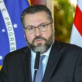

# Ernesto Araújo

U.S. Department of State from United States via Wikimedia Commons · [origem](https://commons.wikimedia.org/wiki/File:Ernesto_Ara%C3%BAjo_(46571408771)_(cropped).jpg)

**Cargo à época:** Ministro das Relações Exteriores (até mar/2021)  
**Grupo:** Outros ministérios e órgãos federais

> 🔎 Conferido pela busca; cópias datadas das fontes no [arquivo de fontes](https://github.com/nk-ls/anatomia-do-caos-fontes). Cada ato tem a sua fonte. [Como verificamos](../docs/verificacao.md). Encontrou um erro ou um ato que falta, a favor ou contra? Abra uma *issue* com a fonte.

## O que fez, em ordem

🟢 **1** a favor · 🔴 **3** contra · ⚪ **2** processual

- 🔴 **22/04/2020** · *270 dias antes da 1ª vacina · 2.906 mortes até aqui* (declaração) Publicou em blog o texto "Chegou o Comunavírus", dizendo que a pandemia era usada para implantar o comunismo e criticando a OMS [fonte](https://observador.pt/2020/04/22/ministro-brasileiro-diz-que-pandemia-e-usada-para-implantar-o-comunismo-e-ataca-oms/) · [cópia arquivada](https://github.com/nk-ls/anatomia-do-caos-fontes/blob/main/arquivo/observador-pt-2020-04-22-ministro-brasileiro-diz-que-pandemia-e-usada-para-implantar-o-com-337991fa/2026-10-24.html)
- ⚪ **09/2020** · *cerca de 4 meses antes da 1ª vacina* (fato) Brasil aderiu ao Covax Facility pela opção mínima (10% da população); Araújo atribuiu a escolha ao Ministério da Saúde [fonte](https://www.correiobraziliense.com.br/politica/2021/05/amp/4925283-ernesto-araujo-diz-que-foi-decisao-da-saude-aderir-ao-minimo-da-covax-facility.html) · [cópia arquivada](https://github.com/nk-ls/anatomia-do-caos-fontes/blob/main/arquivo/correiobraziliense-com-br-politica-2021-05-amp-4925283-ernesto-araujo-diz-que-foi-decisao--0d49473f/2026-10-24.html)
- 🟢 **14/01/2021** · *3 dias antes da 1ª vacina · 207.095 mortes até aqui* (fato) Telefonou ao chanceler indiano pedindo a liberação de 2 milhões de doses da vacina AstraZeneca [fonte](https://www.agazeta.com.br/brasil/com-aviao-prestes-a-decolar-ministro-de-bolsonaro-apela-a-indianos-por-vacinas-0121) · [cópia arquivada](https://github.com/nk-ls/anatomia-do-caos-fontes/blob/main/arquivo/agazeta-com-br-brasil-com-aviao-prestes-a-decolar-ministro-de-bolsonaro-apela-a-indianos-p-a779e353/2026-10-24.html)
- 🔴 **18/05/2021** · *121 dias depois da 1ª vacina · 439.050 mortes até aqui* (declaração) Disse à CPI que ajudou na importação de insumos da Índia para produção de cloroquina [fonte](https://www.folhavitoria.com.br/politica/cpi-araujo-diz-que-ajudou-na-importacao-de-insumos-da-india-para-cloroquina/) · [cópia arquivada](https://github.com/nk-ls/anatomia-do-caos-fontes/blob/main/arquivo/folhavitoria-com-br-politica-cpi-araujo-diz-que-ajudou-na-importacao-de-insumos-da-india-p-4ed1f70c/2026-10-24.html)
- 🔴 **18/05/2021** · *121 dias depois da 1ª vacina · 439.050 mortes até aqui* (checagem) Aos Fatos classificou como falsa a afirmação, feita à CPI, de que não provocou atritos com a China [fonte](https://www.aosfatos.org/noticias/na-cpi-ernesto-araujo-mente-ao-dizer-que-nao-provocou-atritos-com-china/) · [cópia arquivada](https://github.com/nk-ls/anatomia-do-caos-fontes/blob/main/arquivo/aosfatos-org-noticias-na-cpi-ernesto-araujo-mente-ao-dizer-que-nao-provocou-atritos-com-ch-96ca848a/2026-10-24.html)
- ⚪ **18/09/2025** (decisão judicial) STF · Decisão do ministro Flávio Dino Pet 10.064/DF: Acolhe pedido da PF contra a posição da PGR. Converte a Pet em inquérito policial, com prazo inicial de 60 dias e sigilo nível 3. A Pet consta como "processo findo" em 19/09/2025 e foi baixada em 18/02/2026, porque virou inquérito sob outro número, não divulgado. Em jan/2026 a PF pediu mais prazo. Situação em out/2026: Em investigação sob sigilo. Nenhum relatório final, denúncia ou arquivamento foi localizado até 24/10/2026. [fonte](https://noticias.stf.jus.br/postsnoticias/a-pedido-da-pf-stf-determina-abertura-de-inquerito-para-investigar-resultados-da-cpi-da-pandemia/) · [cópia arquivada](https://github.com/nk-ls/anatomia-do-caos-fontes/blob/main/documentos/controle/STF_Pet10064_decisao_Dino_2025-09-18.pdf)

## Na CPI da Covid

> ⚖️ **Pedido de indiciamento não é condenação.** É uma recomendação da CPI aos órgãos de investigação. Toda pessoa tem direito à presunção de inocência.

**Crimes apontados no relatório final (26/10/2021):** epidemia com resultado morte (CP art. 267 §1º); incitação ao crime (CP art. 286), c/c art. 29

## O que aconteceu depois

Investigado no inquérito da PF autorizado pelo ministro Flávio Dino (STF, set/2025), sob sigilo, segundo o Correio Braziliense.

## O que a pessoa diz

Na CPI, negou ataques à China e atraso de insumos por suas falas, e atribuiu ao Ministério da Saúde a adesão mínima ao Covax ([fonte](https://www.poder360.com.br/congresso/em-7-horas-de-cpi-ernesto-nega-falas-contra-china-e-cita-bolsonaro-e-pazuello/))

## Fontes da ficha

- https://www12.senado.leg.br/noticias/materias/2021/10/26/veja-a-lista-dos-indiciados-da-cpi-no-relatorio-de-renan-calheiros
- https://istoedinheiro.com.br/cpi-da-covid-veja-lista-de-indiciados-e-crimes-atribuidos
- https://www.correiobraziliense.com.br/politica/2025/09/7251426-dino-abre-inquerito-contra-bolsonaro-e-23-investigados-da-cpi-da-covid.html

---
[← Todos os envolvidos](README.md)
