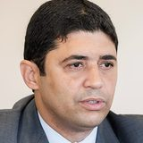

# Wagner Rosário

Palácio do Planalto from Brasilia, Brasil via Wikimedia Commons · [origem](https://commons.wikimedia.org/wiki/File:Wagner_Ros%C3%A1rio_em_30_de_julho_de_2019_(recorte).jpg)

**Cargo à época:** Ministro-chefe da Controladoria-Geral da União  
**Grupo:** Outros ministérios e órgãos federais

> 🔎 Conferido pela busca; cópias datadas das fontes no [arquivo de fontes](https://github.com/nk-ls/anatomia-do-caos-fontes). Cada ato tem a sua fonte. [Como verificamos](../docs/verificacao.md). Encontrou um erro ou um ato que falta, a favor ou contra? Abra uma *issue* com a fonte.

## O que fez, em ordem

🟢 **1** a favor · 🔴 **1** contra · ⚪ **3** processual

- 🟢 **07/2021** · *cerca de 6 meses depois da 1ª vacina* (fato) Auditoria da CGU sobre a Covaxin não achou sobrepreço, identificou documentos fraudados apresentados pela Precisa e enviou o caso à PF [fonte](https://www.infomoney.com.br/?p=1673206) · [cópia arquivada](https://github.com/nk-ls/anatomia-do-caos-fontes/blob/main/arquivo/infomoney-com-br-p-1673206-4cb0e3e2/2026-10-24.html)
- ⚪ **21/09/2021** · *247 dias depois da 1ª vacina · 591.440 mortes até aqui* (fato) Chamou a senadora Simone Tebet de "descontrolada" na CPI e passou à condição de investigado [fonte](https://www.poder360.com.br/cpi-da-covid/wagner-rosario-chama-senadora-de-descontrolada-e-cpi-passa-a-investiga-lo/) · [cópia arquivada](https://github.com/nk-ls/anatomia-do-caos-fontes/blob/main/arquivo/poder360-com-br-cpi-da-covid-wagner-rosario-chama-senadora-de-descontrolada-e-cpi-passa-a--d55d94ea/2026-10-24.html)
- 🔴 **26/10/2021** · *282 dias depois da 1ª vacina · 606.246 mortes até aqui* (conclusão da CPI) Relatório final da CPI, p. 1085: indícios de prevaricação na atuação dele à frente da CGU na apuração da Covaxin, por "ter ignorado o envolvimento de Roberto Dias", ter se omitido quanto a um mercado interno de corrupção no ministério e ter se atido "apenas para aspectos formais". [fonte](https://github.com/nk-ls/anatomia-do-caos-fontes/blob/main/documentos/cpi_relatorio_final_aprovado_2021-10-26.pdf) · [cópia arquivada](https://github.com/nk-ls/anatomia-do-caos-fontes/blob/main/documentos/cpi_relatorio_final_aprovado_2021-10-26.pdf)
- ⚪ **01/08/2022** · *561 dias depois da 1ª vacina · 678.715 mortes até aqui* (decisão judicial) Ministro Ricardo Lewandowski (STF) arquivou, a pedido da PGR, a investigação aberta a partir do relatório da CPI [fonte](https://www.cnnbrasil.com.br/nacional/lewandowski-arquiva-investigacao-contra-ministro-da-cgu/) · [cópia arquivada](https://github.com/nk-ls/anatomia-do-caos-fontes/blob/main/arquivo/cnnbrasil-com-br-nacional-lewandowski-arquiva-investigacao-contra-ministro-da-cgu-86a0b2d1/2026-10-24.html)
- ⚪ **01/08/2022** · *561 dias depois da 1ª vacina · 678.715 mortes até aqui* (decisão judicial) STF · Decisão de Lewandowski: arquivamento Pet 10.062/DF (prevaricação): Acolhe o arquivamento pedido pela PGR, com a ressalva do art. 18 do CPP. Situação em out/2026: Arquivado. Trânsito em julgado em 09/08/2022. [fonte](https://portal.stf.jus.br/processos/detalhe.asp?incidente=6307910) · [cópia arquivada](https://github.com/nk-ls/anatomia-do-caos-fontes/blob/main/documentos/controle/STF_Pet10062_arquivamento_2022-08-01.pdf)

## Na CPI da Covid

> ⚖️ **Pedido de indiciamento não é condenação.** É uma recomendação da CPI aos órgãos de investigação. Toda pessoa tem direito à presunção de inocência.

**Crimes apontados no relatório final (26/10/2021):** prevaricação (art. 319)

## O que aconteceu depois

Ago/2022: o ministro Ricardo Lewandowski (STF) arquivou, em 01/08/2022, a apuração preliminar por prevaricação (Pet 10.062), a pedido da PGR.

## O que a pessoa diz

Afirmou que a CGU atuou adequadamente no controle da compra da Covaxin e que o cancelamento do contrato mostra que não houve crime ([fonte](https://www.lex.com.br/ministro-lewandowski-atende-pedido-da-pgr-e-arquiva-investigacao-da-cpi-contra-ministro-da-cgu/))

## Fontes da ficha

- https://istoedinheiro.com.br/cpi-da-covid-veja-lista-de-indiciados-e-crimes-atribuidos
- https://www.cnnbrasil.com.br/nacional/lewandowski-arquiva-investigacao-contra-ministro-da-cgu/
- https://www.poder360.com.br/cpi-da-covid/stf-arquiva-acao-da-cpi-da-covid-contra-ministro-da-cgu/

---
[← Todos os envolvidos](README.md)
